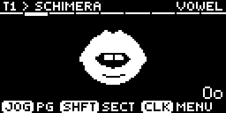
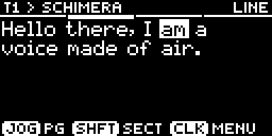
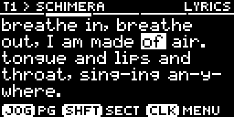

# Schimera

A physically modeled human voice for [Schwung](https://github.com/charlesvestal/schwung) on Ableton
Move. There are no samples: every sound comes from a simulated airway, with lungs, vocal folds,
tongue, lips and nose. Type some words and Schimera speaks them, sings them a syllable per pad, or
holds a vowel while you sweep its mouth with pad pressure.



A port of Jameson Hodge's [CHIMERA](https://github.com/jamesondh/chimera-vocal-synth) engine,
lightened to run on the Move.

## Install

Needs Schwung 1.8.0 or newer. Open Schwung Manager (`move.local:7700`), go to the module list and
install **Schimera** from Sound Generators. Then load it on a track like any other synth.

## Getting started

1. Load Schimera on a track. The first page is the preset browser: turn the jog wheel to try
   the factory sounds.
2. Pick a preset for each mode to hear what it does: **Spoken Word** (Speak), **Twinkle Girl**
   (Sing), **Vowel Pad** (Vowel).
3. Play the pads. How hard you strike a pad sets how much breath goes into the note.

One voice plays at a time. **Mode** on the Play page switches between Speak, Sing and Vowel, and
the pages change to suit the mode.

## The three modes

### Speak



A pad speaks the whole line of lyrics at its pitch, with the rhythm and intonation of speech. A
question ends high and a statement falls. Pressing a new pad starts the line again; letting go
doesn't stop it.

The **Line** page shows the text and lights the word being said.

| Knob | What it does |
|---|---|
| **Rate** | How fast the line is spoken |
| **Expr** | How much the pitch moves (flat to lively) |

### Sing



Each pad sings the next syllable of the lyrics at its pitch, so you play the words like a melody.
The **Lyrics** page lights the syllable that's sounding. Before you've played, it lights the one
the next pad will sing.

- **Playing legato**: press a pad while another is still held and the singing runs on without a break.
  Let go of the newer pad and it glides back to the older one.
- **Pos** is the syllable the next pad sings, and it moves on as you play. Turn it to jump
  anywhere in the lyrics, for example back to 0 to start the song over.
- **Hold a syllable over several notes**: type a lone `~` (or `-`) between words. Each one carries
  the syllable before it onto one more pad: `love ~ ~ you` sings "love" over three pads, then
  "you".
- **Legato** (Pitch page) sets what a legato pad does. **Next** sings the next syllable; **Hold**
  glides the syllable already sounding to the new pitch, and the lyrics move on at the next pad
  you play on its own.
- **Vibrato** and **VRate** (Pitch page) set how deep and how fast the vibrato is.

### Vowel

A held vowel: a pad sets the pitch and breathes, as hard as you struck it. This is the mode for
pads, drones and talk-box sounds.

- **Vowel** sweeps the mouth along Oo, Oh, Ah, Eh and Ee. The **Vowel** page draws the mouth as
  it moves.
- **Push**: pad pressure pushes the vowel further along that path, by as much as Push says.
  Negative values push it back the other way.
- **Hold** keeps the voice droning with no pad down.
- **Mouth** page: shape the mouth by hand: tongue **Front** and **Height**, **Jaw**, **Round**,
  **Lips**, **Pout** and tongue-tip **Curl**. **Pick** jumps it straight to one of 13 vowels.
  The page draws the mouth you've made.
- **Throat** page: **Larynx** height, false **Folds**, **Twang**, tongue **Root**, **Nasal** and
  **Side** (a lateral, "l"-like tongue).
- **Pitch** page: **Vibrato**, **VRate**, and **Glide** between notes.

## Lyrics

Speak and Sing share the same lyrics.

- **Words** picks built-in lyrics: Made of Air, Twinkle, Daisy Bell, Hello, and the single
  syllables Ah, Ooh, La and Doo. Choose **Custom** for your own.
- **Lyrics**: click it to open the keyboard and type your own. English words are looked up in a
  pronouncing dictionary.
- Punctuation shapes Speak's phrasing: a `?` ends high, a `.` falls, and commas break the line
  into phrases.
- A hyphen inside a word forces where its syllables split: `an-y-where`.

## The voice

On every mode's Play page, **Fem** and **Child** blend the body between male, female and child.
The blend is continuous, so anything in between works too. **Volume** is the output level.

The **Tone** page applies to every mode:

| Knob | What it does |
|---|---|
| **Breath** | Lung pressure: how loud and pushed the voice is |
| **Press** | How tightly the vocal folds press together: breathy to pressed |
| **Bright** | Brightness of the voice |
| **Airy** | Breath noise mixed into the tone |
| **Rough** | Roughness, rasp |
| **Fry** | Vocal fry, the creaky low register |
| **Hush** | Whisper: breath only, no voiced tone |
| **Drift** | Slow, natural pitch wander |

## Presets

15 factory presets: Spoken Word, Hello, Quiet Voice and Auctioneer (Speak); Made of Air, Twinkle
Girl, Daisy Child, Ooh Choir, Robot Diva and Baritone La (Sing); Vowel Pad, Drone Ah, Talk Box,
Whisper and Throat Singer (Vowel). Save your own with Schwung's My Presets.

## CPU and settings

The voice is a full airway simulation, so it costs more CPU than a typical synth. Two settings
live in Schwung Manager (`move.local:7700` → Modules → Schimera) rather than on the Move. They're
your device's budget, not part of a sound, so a set saved on a CM5 never overloads a CM4.

- **Engine**: **Light** (the default) uses about 20% of one CM5 core and runs on CM4 and CM5.
  **Full** is the original airway, about 60% of a CM5 core, CM5 only.
- **Buffer**: how far ahead the voice renders: Low (6 ms), Normal (12 ms) or Safe (23 ms). If you
  hear dropouts, raise it.

Both take effect within a second, without reloading the module. Schwung's Help viewer (Modules →
Schimera) carries a short version of this guide on the Move.

## Building from source

```bash
./scripts/build.sh      # needs Docker and node
./scripts/install.sh    # copies dist/chimera to the Move (MOVE_HOST overrides move.local)
```

The installer never restarts anything: a module the host has already loaded keeps its old code
until the host restarts. Build and engine notes are in [DEVELOPMENT.md](DEVELOPMENT.md).

## License

MIT, as is the CHIMERA engine (`engine/`). The CMU Pronouncing Dictionary keeps its own license
(`engine/public/data/CMUDICT-LICENSE.txt`).
